# API 服务端技术解析文档（白痴版）

> 本文档对 API 服务端做**完整技术解析**：每个端口、每个类、每个线程、每把锁、每个字段都讲清楚。
> 但讲法上假设你是个白痴（褒义）：每个技术名词都先翻译成人话再展开。
> 想看更正经的版本见《API_ARCHITECTURE.md》，想对照重构前后见《REFACTOR_CHANGES.md》。
> 文中示意图均为 Mermaid 绘制，GitHub / CLion 的 Markdown 预览可直接渲染。

---

## 一、这个程序到底在解决什么问题

**技术定位**：一个 C++17 摄像头设备管理服务端，负责在「桌面客户端」和「树莓派摄像头终端」之间做中转：

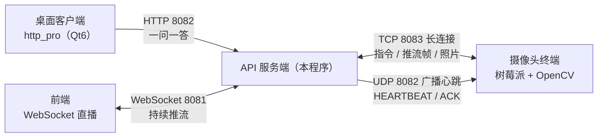

**要解决的技术问题**：

1. 摄像头是"哑终端"，只会连服务器、发数据、听指令 → 需要**一套自定义 TCP 协议**；
2. 一个服务端要管多个摄像头 → 需要**会话管理 + ID 分配**；
3. HTTP 请求和 TCP 数据是**两个线程世界** → 需要**线程安全与跨线程同步**；
4. 项目要长期维护 → 需要**分层架构**防止代码腐烂成屎山。

---

## 二、四个网络通道技术解析

### 2.1 HTTP 通道（8082）—— 客户端唯一的交互入口

- **底层**：SDK 的 `CTL::WebServlet` 封装，`HttpServer` 类把它包了一层薄壳。
- **路由**：不是常见的框架路由，是**自研 Router**（`Router.h/.cpp`）：

```cpp
// 注册：把 URL 切成一段段存起来，{id} 处存参数名
void Router::Add("GET", "/api/camera/{id}/frame", handler);
// 匹配：请求来了逐段比对，字面量必须相等，{id} 段抓值塞进 PathParams
bool Router::Route(CTL::Request& req, CTL::Response& res);
```

> 白痴版解释：路由表就是一张"门牌对照表"。`{id}` 是通配符——凡是 `/api/camera/3/frame`、`/api/camera/7/frame` 都进同一扇门，门后有人把"3"或"7"递给你。

**9 条路由全景**（对外 API 契约）：

| 方法 | 路径 | 干什么 | 返回 |
|------|------|--------|------|
| POST | /api/login | 登录校验 | `{"Account":..,"Password":..,"status":"success"}` |
| GET | /api/GetID | 申请一个摄像头工号 | `{"cam0":0}` |
| GET | /api/camera/list | 列出在线摄像头 | `{"devices":[...],"count":n}` |
| GET | /api/camera/{id}/frame | 取 3 号摄像头最新一帧 | JPEG 二进制流 |
| POST | /api/camera/{id}/photo | 让 3 号摄像头拍照并保存 | `{"photoId":..,"deviceId":..,"size":..}` |
| POST | /api/camera/{id}/stream/start | 开直播 | `{"code":200}` |
| POST | /api/camera/{id}/stream/stop | 关直播 | `{"code":200}` |
| GET | /api/photo/{photoId} | 按编号取照片 | JPEG 二进制流 |
| GET | /api/photo/list/{deviceId} | 列某摄像头的照片 | `{"photos":[...]}` |

### 2.2 TCP 通道（8083）—— 摄像头的"永久电话线"

**为什么用 TCP 长连接**：摄像头要持续推流帧、随时听指令，短连接每次重新握手成本高，所以一条连接从登录用到离线。

**技术核心：一个字节一个字节地解析"文本头 + 二进制体"双模式协议。**

`TcpCameraChannel::RecvLoop()` 里维护一个状态机（就两个状态）：

```cpp
size_t binaryRemaining_ = 0;   // 0 = 行模式；>0 = 二进制模式，还剩多少字节
bool   binaryIsPhoto_  = false; // 当前二进制数据是照片还是推流帧
```

解析逻辑（白痴版）：

1. **行模式**：一个字节一个字节地攒，攒到 `\n` 就是一句话，交给 `ProcessLine()`；
2. 如果这句话是 `STREAM_DATA 8000` 这种带数字的 → 切到**二进制模式**，记下"还要收 8000 字节"；
3. **二进制模式**：闷头收字节，收满 8000 字节 → 拼成一帧 JPEG → `StoreFrame()` 或 `StorePhoto()` → 回到行模式。

状态机图（就两个状态的来回切换）：

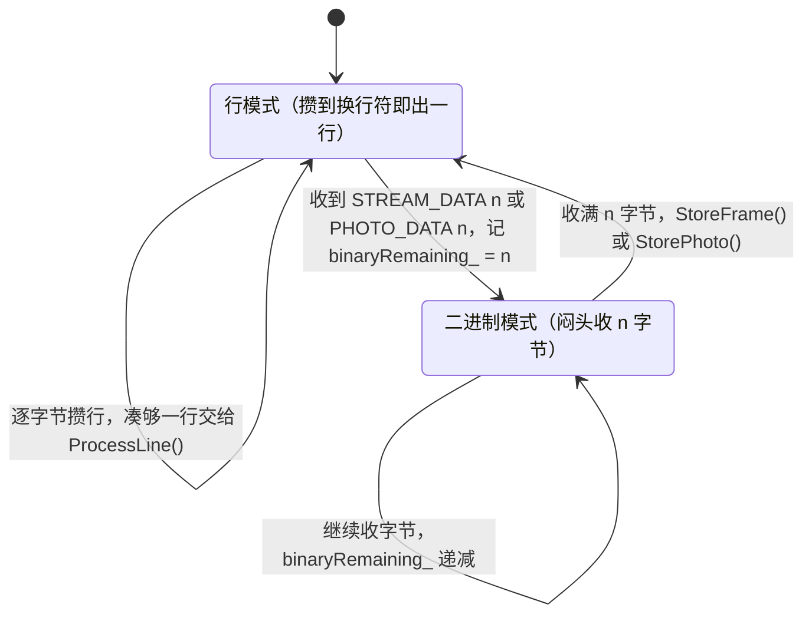

**ProcessLine 支持的黑话**（全部在 `domain/Protocol.h` 定义常量）：

| 终端发来 | 服务器动作 |
|----------|-----------|
| `PONG` | 刷新 `lastHeartbeat_`（证明还活着） |
| `REQUEST_ID` | 调 `allocator_->Allocate()`，回 `ASSIGN_ID{id}` |
| `LOGIN` | 拿注入的账号密码比对，回 `LOGIN_OK` / `LOGIN_FAIL` |
| `STREAM_DATA n` | 进二进制模式，收 n 字节 → 存帧队列 |
| `PHOTO_DATA n` | 进二进制模式，收 n 字节 → 存照片并叫醒等照片的人 |

**心跳判活**：`IsOnline()` 用 `steady_clock::time_point lastHeartbeat_` 算——距离最后一次 `PONG` 超过 `onlineTimeoutSeconds`（默认 30 秒）就判离线。注意：**心跳不是 TCP 层 ping，而是终端主动发的 `PONG` 文本**，服务端只负责计时。

### 2.3 UDP 通道（8082 广播）—— 摄像头怎么"找到组织"

**技术问题**：服务端和摄像头可能不在同一网段，摄像头启动时不知道服务器在哪。

**解法**：`UdpHeartbeatService` 定时向广播地址发心跳包（`HEARTBEAT`），摄像头收到后回一个 `HEARTBEAT_ACK`，服务端从 ACK 的源地址就知道"哦，这里有个摄像头"（这叫 **UDP 打洞**）。

**节奏**（白痴版：喊一嗓子 → 竖起耳朵听 3 秒 → 喘 5 秒，循环）：

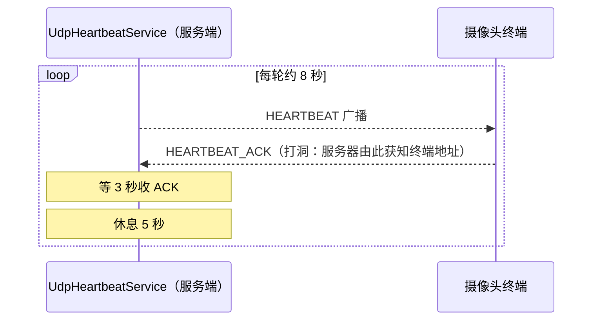

打洞之后的完整数据流（UDP 只负责"找到人"，找到后画面走 TCP 拉流）：

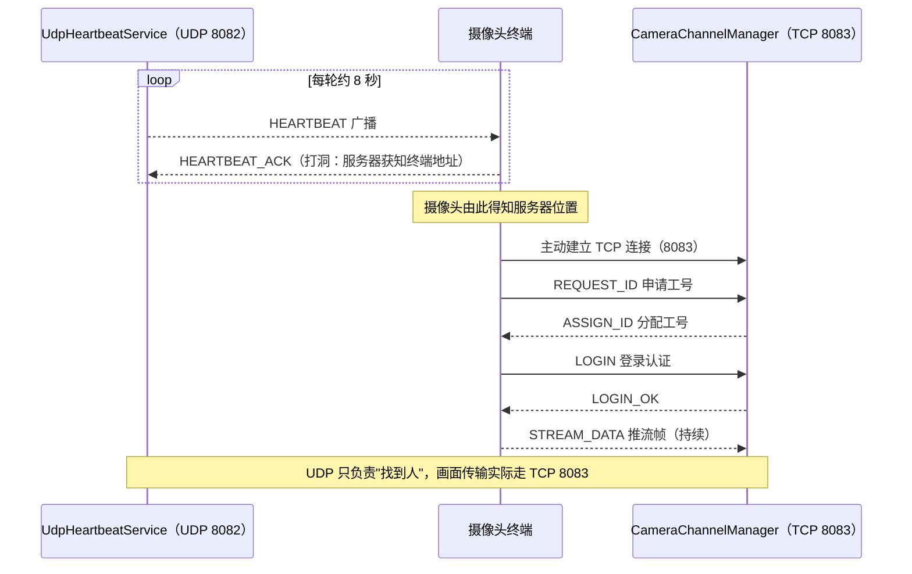

UDP 和 HTTP 共用 8082 端口不冲突的原因：TCP 和 UDP 是两套独立的协议栈，内核按协议区分，互不干扰。

### 2.4 WebSocket 通道（8081）—— 直播专用频道

**为什么不能靠 HTTP**：HTTP 是一问一答，客户端想持续看画面得每秒轮询几百次，又累又卡。

`WebSocketStreamService` 开独立端口 8081，等前端连进来后，**持续**把摄像头最新帧 `SendBinary()` 推出去。它持有 `CameraChannelManager`，前端一连上就能拿到所有在线摄像头的画面流。

推流数据流图：

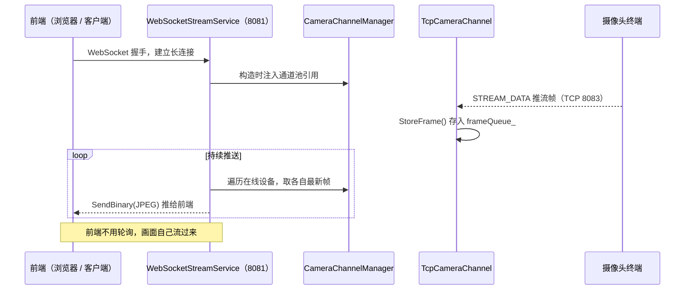

> 白痴版：HTTP 是"你问一句我答一句"，WebSocket 是"电话接通后我一直在说"。

---

## 三、五层架构逐层技术解析

依赖方向：**只能往下指**（`web → app → domain → common`，`infra → app`），由 CMake 在编译期强制。

五层全景图（虚线 = AppContext 依赖注入，实线 = 编译期依赖方向）：

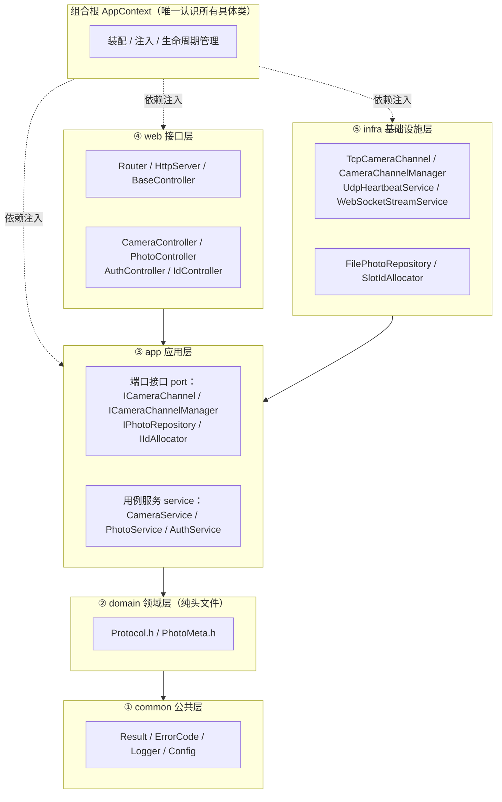

### 3.1 common 公共层 —— 全楼的公用水电煤

**`Result<T>`（Result.h）—— 本项目的错误处理宪法**

```cpp
Result<T>::Ok(value)                 // 成功：带着货
Result<T>::Fail(ErrorCode, message)  // 失败：带着"为什么失败"
Result<void> 特化                    // 不需要返回值时用
```

> 白痴版：所有函数都像外卖骑手——要么把餐送到（Ok），要么带回来一个"订单取消原因"（Fail）。**不抛异常穿越层边界**，错误就是普通数据，谁调用谁处理。这替代了旧代码里 `bool status` 出参 + 空字符串判断的野路子。

**`ErrorCode`（ErrorCode.h）—— 错误码到 HTTP 状态码的翻译官**

| ErrorCode | 白话 | 翻译成 HTTP |
|-----------|------|-------------|
| kOk | 成了 | 200 |
| kInvalidArgument | 参数不对 | 400 |
| kUnauthorized | 没权限 | 401 |
| kNotFound / kDeviceOffline | 没有这东西/摄像头不在线 | 404 |
| kTimeout | 等太久了 | 504 |
| kIoError / kInternal | 内部出岔子 | 500 |
| kNoIdAvailable | 工号发完了 | 503 |

**`Logger`**：线程安全日志，宏 `LOG_INFO/WARN/ERROR/DEBUG`，带级别过滤。
**`ServerConfig`**：配置结构体，`LoadFromJson()` 读 `config.json`，读不到回退 `Default()`，保证程序不因缺配置而崩。

### 3.2 domain 领域层 —— 字典和户口本（纯头文件，零依赖）

- **`Protocol.h`**：协议黑话大全。所有 `"PONG"`、`"STREAM_DATA"` 这类字符串定义为常量，**消灭魔法字符串**——要改协议只改这一处。
- **`PhotoMeta.h`**：照片户口信息 `{photoId, deviceId, size}`，一个纯值对象。

> 白痴版：这层是"名词解释"层。全楼的人说"PONG"都必须和这里定义的一个意思，不许自己发明方言。

### 3.3 app 应用层 —— 岗位说明书 + 业务流程

**这是整个架构的心脏。** 分成两半：

**上半：port（端口接口）—— 四张"岗位说明书"**

```cpp
class ICameraChannel {          // 单条摄像头通道该会什么
    virtual int DeviceId() const = 0;
    virtual bool IsOnline() const = 0;
    virtual void SendCommand(const std::string&) = 0;
    virtual std::vector<char> GetLatestFrame() = 0;
    virtual Result<std::vector<char>> TakePhoto(int timeoutMs) = 0;
};
class ICameraChannelManager {}; // 通道池：Start/Stop/OnlineDevices/Find
class IPhotoRepository {};      // 照片仓库：Save/Load/List
class IIdAllocator {};          // ID 分配：Allocate
```

> 白痴版：接口只写"**你该会干什么**"（会拍照、会存照片），**不写"你怎么干"**（用 TCP 还是用信鸽）。业务层只跟说明书打交道，具体干活的师傅在楼下（infra）。

**下半：service（用例服务）—— 业务流程编排**

| 服务 | 编排的业务 | 只依赖 |
|------|-----------|--------|
| CameraService | 在线列表、取帧、拍照、推流控制 | ICameraChannelManager, IPhotoRepository |
| PhotoService | 按 ID 取照片、按设备列清单 | IPhotoRepository |
| AuthService | 账号密码比对 | 无（值注入） |

> 白痴版：service 是"导演"，port 是"演员合同"，infra 是"实际演员"。导演只认合同，换演员不用改剧本。

### 3.4 web 接口层 —— 前台接线员（薄得不能再薄）

- **`Router`**：`{id}` 占位符路由表（前面讲过）。
- **`BaseController`**：所有控制器的爹，提供统一响应封装：
  - `WriteJson` / `WriteError`（`{"code":..,"msg":..}`）/ `WriteJpeg`（JPEG 二进制）
  - `ToHttpStatus()`：ErrorCode → HTTP 状态码映射
  - `GetIntParam()`：从 `PathParams` 抠出 int 参数
- **`HttpServer`**：SDK WebServlet 的薄封装，所有请求统一扔给 Router。
- **4 个 Controller**：Camera / Photo / Auth / Id，每个方法就三步——**解析参数 → 调 service → 用 Result 写响应**。

> 白痴版技术纪律：**控制器里不许出现业务逻辑**。它只是翻译官：把 HTTP 语言翻译成 service 语言，再把 Result 翻译回 HTTP。谁在控制器里写 if-else 业务判断，谁就该挨打。

### 3.5 infra 基础设施层 —— 真正的"工人"

| 类 | 实现 | 关键技术点 |
|----|------|-----------|
| TcpCameraChannel | ICameraChannel | 双模式协议解析状态机、`CTL::Queue` 帧队列、条件变量拍照同步 |
| CameraChannelManager | ICameraChannelManager | accept 循环、注册等待 5 秒、`shared_mutex` 会话表 |
| UdpHeartbeatService | — | 广播心跳 + ACK 打洞 |
| WebSocketStreamService | — | 8081 持续推流 |
| FilePhotoRepository | IPhotoRepository | 文件落盘、`shared_mutex` 并发读写 |
| SlotIdAllocator | IIdAllocator | 20 个槽位、顺序找空位、池满报 kNoIdAvailable |

---

## 四、并发模型深度解析（本项目的技术含量所在）

### 4.1 都有哪些线程

| 线程 | 所在类 | 干什么 |
|------|--------|--------|
| HTTP 处理线程（SDK 内部，可能有多个） | HttpServer | 处理客户端请求 |
| 接收线程 `recvThread_`（每个摄像头一条） | TcpCameraChannel | 死循环收数据、解析协议 |
| accept 线程 | CameraChannelManager | 死循环等新摄像头连接 |
| UDP 发/收线程 | UdpHeartbeatService | 广播 + 收 ACK |
| WS 推送线程 | WebSocketStreamService | 推流 |
| 主线程 | main | 阻塞在 httpServer_.Run() |

**核心矛盾**：HTTP 线程要"取帧、拍照"，但帧和照片是 TCP 接收线程收的——**两个线程要交换数据**。

### 4.2 最新帧缓存：`CTL::Queue`（生产者-消费者）

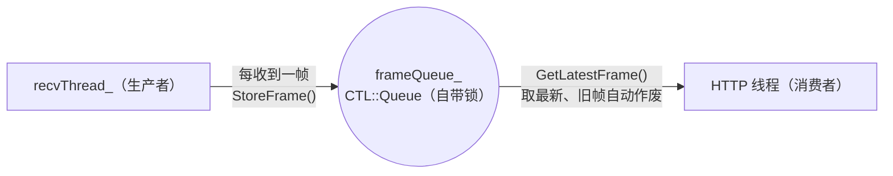

> 白痴版：帧队列是"取号机"。摄像头疯狂放号（每帧一个号），前台只喊"最新的那个号"——取帧永远取最新，旧帧自动作废，这就是为什么拿到的画面永远是最新鲜的。`CTL::Queue` 是 SDK 的线程安全队列，内部自带锁，不需要手动加 mutex。

### 4.3 拍照同步：`mutex + condition_variable`（跨线程握手）

这是全项目最值得看的同步逻辑。两个线程、两个阶段：

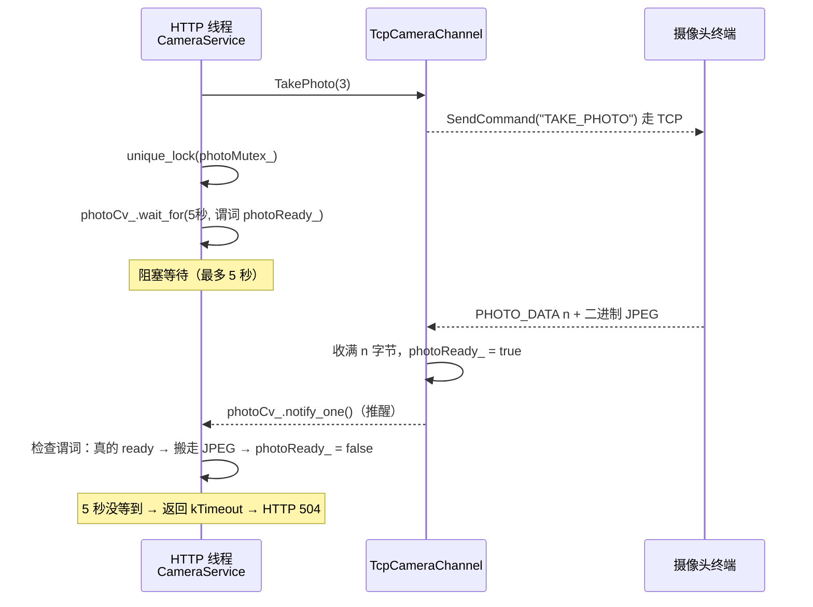

> 白痴版：前台打电话让摄像头拍照（send），然后**在沙发上眯 5 秒**（wait_for）。TCP 小哥收到照片后**推醒前台**（notify_one）。前台睁眼一看：有照片就拿走，5 秒到了还没照片就回复客户"超时了"。
>
> **技术细节**：`wait_for` 必须带谓词（`photoReady_`），防止**虚假唤醒**（spurious wakeup）——操作系统可能无缘无故叫醒你，醒来必须自己检查"照片真的到了吗"。而且谓词检查、等待、修改 `photoReady_` 全程在 `photoMutex_` 保护下，否则就是数据竞争。

### 4.4 会话表：`shared_mutex`（读多写少的优化）

`CameraChannelManager` 的 `unordered_map<int, channel>` 用 `shared_mutex` 保护：

- **读**（找设备、列在线列表，非常频繁）：`shared_lock`，多个读者可以同时读；
- **写**（设备上下线，很少发生）：`unique_lock`，独占。

> 白痴版：普通 mutex 是"单人厕所"——管你拉屎还是洗手都得排队。shared_mutex 是"男厕所+小便池"——洗手（读）的人可以并排站，只有要拉屎（写）的人才锁大门。列表接口一秒被打 1000 次，全靠它不卡。

---

## 五、一次请求的完整技术走查

### 5.1 GET /api/camera/3/frame（取帧）

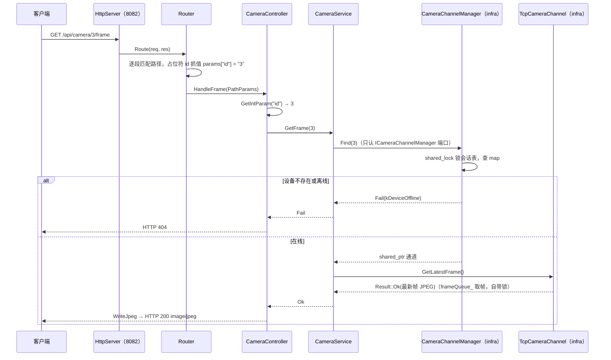

**技术要点**：第 5、6 步之间没有任何全局单例，全走接口指针。`CameraService` 手里只有 `ICameraChannelManager&`，它根本不知道地图、锁、TCP 的存在——这就是依赖倒置的威力。

### 5.2 POST /api/camera/3/photo（拍照）

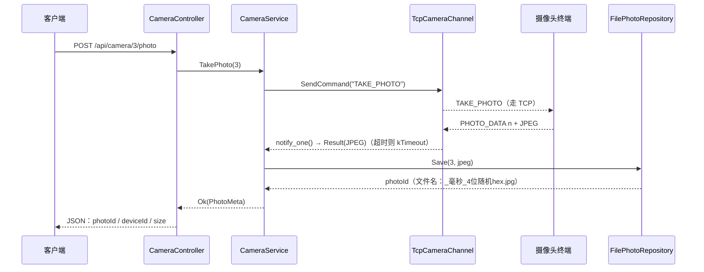

---

## 六、组合根 AppContext —— 全楼唯一的"人事部"

这是六边形架构的最后一环：**谁负责把"说明书"和"工人"对上号？**

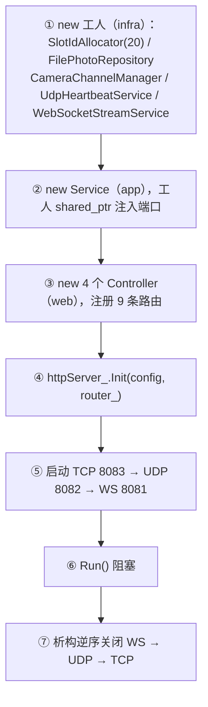

> 白痴版：AppContext 是唯一的"招聘经理"。全楼只有它同时认识所有具体的人（具体类）。其他楼层只认识岗位说明书（接口）。好处：**整个程序的对象关系图只在这一个文件里**，想看懂程序怎么搭的，看 AppContext.cpp 就够。

**加新功能的固定套路**（记下来，白痴都能扩展）：

```
domain 加模型 → app/port 加接口 → app/service 写用例
→ infra 写实现 → web/controller 注册路由 → AppContext 装配一行
```

---

## 七、CMake 分层构建 —— 用编译器当"架构警察"

**技术思想**：光靠"团队约定"保不住分层，三个月后必有人乱引头文件。所以把每一层做成独立静态库，**谁依赖谁写死在链接关系里**：

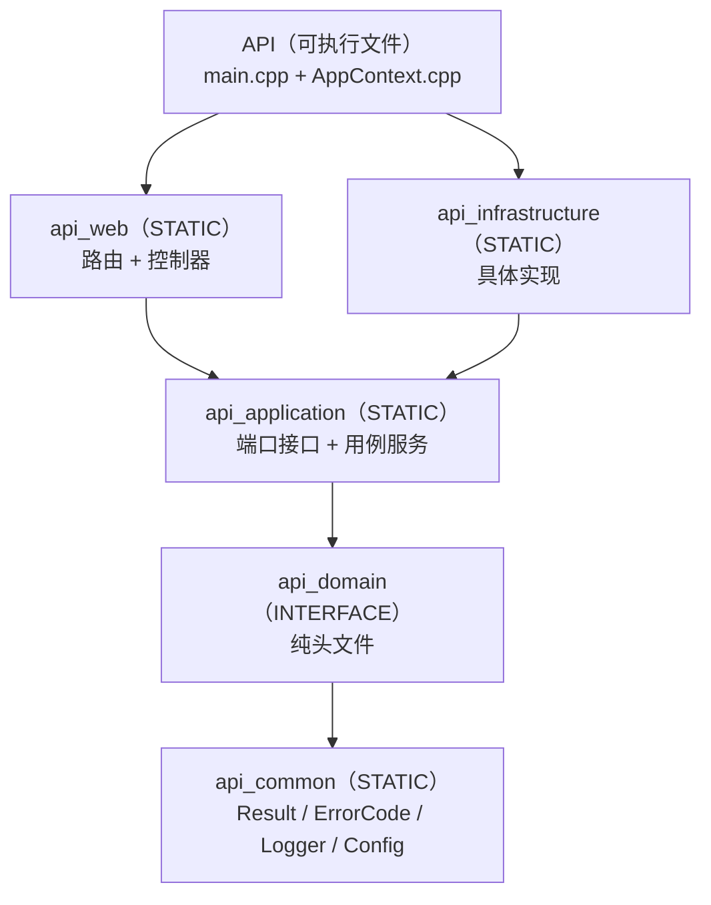

**效果**：

- infra 想 include web 的头？→ **链接直接报错**，因为 api_infrastructure 没链 api_web；
- web 和 infra 互相不认识 → 六边形架构天然成立；
- OpenCV 只链在最终可执行文件上 → 各层代码不沾 OpenCV，替换图像库不用动业务层。

> 白痴版：把每层楼焊死不同的门禁卡。你想从 4 楼（web）串门去 3 楼（app）可以，想从 1 楼（infra）闯进 4 楼？门禁直接报警（编译失败）。

---

## 八、配置文件 config.json 技术解析

```json
{
    "httpAddress": "192.168.1.175", "httpPort": 8082,
    "tcpPort": 8083,
    "wsAddress": "192.168.1.175",   "wsPort": 8081,
    "photoDir": "./photos",
    "photoTimeoutMs": 5000,          // 拍照最多等 5 秒
    "registerTimeoutMs": 5000,       // 新连接最多等 5 秒注册
    "onlineTimeoutSeconds": 30,      // 30 秒没 PONG 判离线
    "account": "123456", "password": "123456"
}
```

**技术意义**：重构前这些值散落在 main.cpp、URL.cpp 里硬编码，改个端口要重新编译。现在全部从 JSON 加载，`LoadFromJson` 失败自动回退 `ServerConfig::Default()`——**配置错误不会让程序崩溃**。

---

## 九、技术术语速查表（白痴版）

| 术语 | 人话 |
|------|------|
| 端口（Port） | 门牌号。程序开 8082/8083/8081 三个门等不同的人来 |
| TCP 长连接 | 接通就不挂的电话线，适合频繁对话 |
| UDP 广播 | 拿大喇叭对整栋楼喊话，不等人回执 |
| WebSocket | 直播间，通了就一直有画面 |
| 心跳（PONG） | 摄像头每过一会儿喊一声"我还活着" |
| 端口接口（port interface） | 岗位说明书：只写"会什么"，不写"怎么干" |
| 适配器（adapter） | 翻译官：把 HTTP 话翻译成业务话 |
| 依赖注入（DI） | 招聘经理（AppContext）把工人塞进岗位，而不是工人自己到处找活 |
| Result\<T\> | 外卖骑手：要么送到（Ok），要么带回取消原因（Fail） |
| 条件变量（condition_variable） | 沙发上眯着等，有人推你才醒 |
| 虚假唤醒 | 没来人也推你一下，所以醒来必须自己再检查一遍 |
| shared_mutex | 洗手可以并排，拉屎才锁门 |
| 组合根 | 全楼唯一的招聘经理，认识所有具体的人 |
| 静态库分层 | 每层楼焊不同门禁卡，串错门编译就报错 |
| 状态机 | 机器有两个状态（收文字/收图片），按收到的内容切换 |

---

## 十、总结：这套架构到底图什么

1. **加功能不怕改崩老代码**：新功能 = 新接口 + 新实现 + 新路由，老代码一行不动；
2. **业务逻辑可以脱离网络测试**：给 `CameraService` 塞个假 `ICameraChannelManager`（mock）就能单元测试，不用真的连摄像头；
3. **换实现不换业务**：想把照片从存文件换成存数据库，只重写 `FilePhotoRepository`，上层无感；
4. **编译器当警察**：谁想乱跨层，CMake 链接先不答应；
5. **错误有脸面**：`Result<T>` + `ErrorCode` 让每个失败都有明确的 HTTP 状态码，而不是糊成一团 500。
